# Flight Delays Are Contagious: Predicting Delay Propagation Across Consecutive Aircraft Operations

[](https://flight-delay-propagation.vercel.app)
[](public/flight_delay_propagation_ieee_paper.pdf)
[](https://www.python.org/)
[](https://scikit-learn.org/)
[](https://www.transtats.bts.gov/)
[](LICENSE)

An empirical research study and machine learning pipeline investigating how upstream flight arrival delays propagate across domestic aircraft turnaround rotations to cause downstream departure delays. Based on **6.77 million commercial flights** and **6,124 unique physical aircraft** from the United States Bureau of Transportation Statistics (BTS) across all 12 calendar months of 2025.

---

## Table of Contents

- [1. Research Motivation & Core Thesis](#1-research-motivation--core-thesis)
- [2. Live Application & Manuscript](#2-live-application--manuscript)
- [3. Dataset Overview & Data Quality Audits](#3-dataset-overview--data-quality-audits)
- [4. Methodology & Aircraft Rotation Reconstruction](#4-methodology--aircraft-rotation-reconstruction)
  - [4.1 Chronological Tail-Number Tracking](#41-chronological-tail-number-tracking)
  - [4.2 The Turnaround Deficit Formulation](#42-the-turnaround-deficit-formulation)
  - [4.3 Zero-Leakage Information Boundary](#43-zero-leakage-information-boundary)
- [5. Feature Engineering Hierarchy](#5-feature-engineering-hierarchy)
- [6. Exploratory Data Analysis (EDA) & Empirical Findings](#6-exploratory-data-analysis-eda--empirical-findings)
  - [6.1 The Turnaround Deficit Cliff](#61-the-turnaround-deficit-cliff)
  - [6.2 Airframe Fatigue & Leg Progression](#62-airframe-fatigue--leg-progression)
  - [6.3 Diurnal & Hub Amplification](#63-diurnal--hub-amplification)
- [7. Temporal Experimental Design & Partitioning](#7-temporal-experimental-design--partitioning)
- [8. Model Training, Tuning & Benchmark Results](#8-model-training-tuning--benchmark-results)
  - [8.1 Benchmark Comparison Across Model Families](#81-benchmark-comparison-across-model-families)
  - [8.2 Hierarchical Feature Group Ablation](#82-hierarchical-feature-group-ablation)
  - [8.3 Operational Decision Threshold Optimization](#83-operational-decision-threshold-optimization)
  - [8.4 Regression Delay Magnitude Performance](#84-regression-delay-magnitude-performance)
- [9. Robustness Audits & Generalization Analysis](#9-robustness-audits--generalization-analysis)
  - [9.1 Feature Permutation Importance](#91-feature-permutation-importance)
  - [9.2 Delay Severity Error Stratification](#92-delay-severity-error-stratification)
  - [9.3 Winter Shift-Share Decomposition](#93-winter-shift-share-decomposition)
- [10. Key Empirical Takeaways for Airline Operations](#10-key-empirical-takeaways-for-airline-operations)
- [11. Repository Architecture](#11-repository-architecture)
- [12. Installation & Reproducibility Guide](#12-installation--reproducibility-guide)
- [13. Citation & Acknowledgments](#13-citation--acknowledgments)

---

## 1. Research Motivation & Core Thesis

Flight delays in commercial aviation generate multi-billion-dollar annual operating losses, severe network disruptions, and passenger inconvenience. Conventional flight delay prediction architectures frequently treat flights as **independent, isolated events**—relying primarily on scheduled departure hour, origin weather, and carrier identity. 

In reality, commercial airlines operate high-utilization hub-and-spoke networks where a single physical aircraft performs 4 to 8 consecutive flight segments each day. Because the inbound arrival of leg $i-1$ provides the physical airframe for leg $i$, aircraft turnarounds act as **physical bottlenecks** through which operational delays propagate across the national airspace system.

```
┌─────────────────────────────────┐           Turnaround Buffer (Scheduled - Min Turn)
│ Flight i-1: Inbound Arrival     │                     │
│ Scheduled: 14:00 | Actual: 14:45├─────┐               ▼
└─────────────────────────────────┘     │    ┌─────────────────────┐      ┌──────────────────────────────────┐
                                        ├───►│ Turnaround Deficit  ├─────►│ Flight i: Outbound Departure     │
                                        │    │  Cliff at -15 min   │      │ Scheduled: 15:00 | Actual: 15:40 │
┌─────────────────────────────────┐     │    └─────────────────────┘      └──────────────────────────────────┘
│ Airframe Daily Fatigue History   ├─────┘                                          ▲
│ Legs completed, cumulative delay│                                                 │
└─────────────────────────────────┘                                      Downstream Delay Propagated!
```

### Core Research Questions
1. **Predictive Strength:** *To what extent can inbound delays and ground turnaround mechanics predict whether a subsequent flight departs delayed ($\ge 15$ min)?*
2. **Mechanistic Thresholds:** *Is delay propagation linear, or does it exhibit a discrete phase transition when turnaround buffers are exhausted?*
3. **Cumulative Airframe History:** *Does same-day rotational history (e.g., number of legs flown, accumulated daily delay) provide non-redundant predictive signal over ground mechanics alone?*
4. **Generalization & Stability:** *Does a model trained on spring/summer operations generalize to severe winter conditions (e.g., December convective weather and holiday traffic)?*

---

## 2. Live Application & Manuscript

The findings, interactive visualizations, and reproducible models from this study are deployed and accessible:

- **Interactive Web Platform:** [https://flight-delay-propagation.vercel.app](https://flight-delay-propagation.vercel.app)
  - Features dedicated pages for: **Overview**, **Dataset Audits**, **Methodology**, **Exploratory Analysis**, **Model Architecture**, **Test Set Benchmarks**, **Figure Lightbox Gallery (40+ visualizations)**, and **Research Findings**.
- **Complete Research Manuscript (IEEE Format):** [`public/flight_delay_propagation_ieee_paper.pdf`](public/flight_delay_propagation_ieee_paper.pdf) or [`paper/main.pdf`](paper/main.pdf)
- **Launch Video Presentation:** [`brag-output/brag.mp4`](brag-output/brag.mp4) (1080p presentation showcasing the deployed web app and empirical findings).

---

## 3. Dataset Overview & Data Quality Audits

The research pipeline ingests the complete 2025 calendar year of flight records from the **United States Department of Transportation (DOT) Bureau of Transportation Statistics (BTS)** On-Time Reporting database.

| Metric | Full Ingested Population | Final Analyzed Rotation Cohort |
| :--- | :--- | :--- |
| **Temporal Span** | January 1 – December 31, 2025 (12 months) | January 1 – December 31, 2025 (12 months) |
| **Total Flight Records** | 7,001,619 operations | **6,768,487 rotation pairs** |
| **Schema Uniformity** | 100% identical 46-column schema | 100% verified zero-leakage pre-departure features |
| **Commercial Carriers** | 14 reporting mainline carriers | 14 reporting mainline carriers |
| **Commercial Airports** | 352 active origin/destination stations | 352 verified stations with geocoordinates |
| **Completed Flights** | 6,879,484 (98.26%) | 6,768,487 valid turnaround pairs |
| **Cancellations** | 102,876 (1.47%) | Excluded (structural absence of turnaround) |
| **Diversions** | 19,259 (0.27%) | Excluded (spatial routing discontinuity) |
| **Tracked Physical Airframes** | 6,124 unique aircraft (`TAIL_NUM`) | 6,124 unique aircraft (`TAIL_NUM`) |
| **Overall Delay Rate ($\ge 15$ min)** | 22.31% of completed flights | 21.64% across rotation cohort |

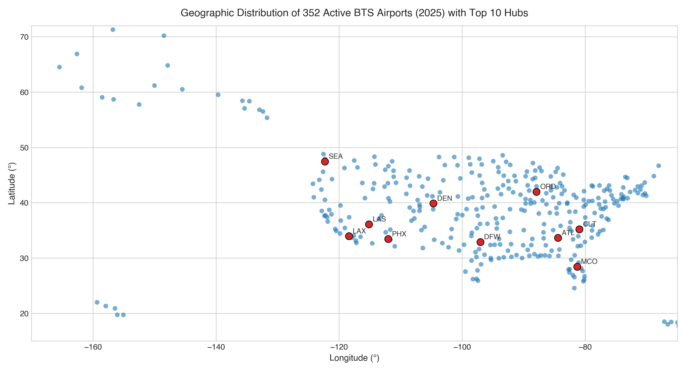
*Figure 1: Geographic distribution and operational flight density across 352 commercial airports in the contiguous United States, Alaska, and Hawaii.*

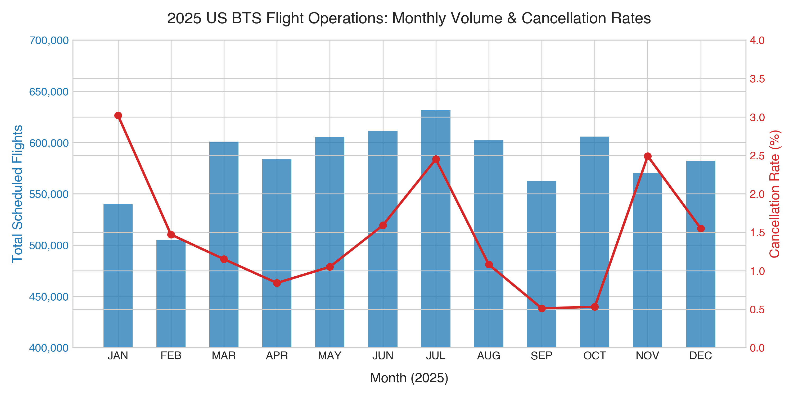
*Figure 2: Monthly completed flight volume and cancellation trends across 2025, highlighting summer travel peaks and winter cancellation spikes.*

### Temporal UTC Normalization & DST Ambiguity Handling
Because commercial flight schedules record timestamps in local airport wall-clock times, calculating elapsed ground time across multi-station routes requires strict chronological synchronization:
1. Every airport was mapped to its canonical IANA timezone database string (`America/New_York`, `America/Chicago`, `America/Denver`, `America/Los_Angeles`, etc.).
2. Timestamps were parsed into UTC taking into account daylight saving time (DST) spring-forward and fall-back boundaries.
3. Overnight flights crossing 00:00 UTC were chronologically ordered using date offset logic, completely preventing negative elapsed durations.

---

## 4. Methodology & Aircraft Rotation Reconstruction

### 4.1 Chronological Tail-Number Tracking
The fundamental unit of observation is not an individual flight, but a **consecutive aircraft turnaround pair** $(F_{i-1}, F_i)$ where flight $F_i$ is operated by the identical physical aircraft that completed flight $F_{i-1}$.

To reconstruct these pairs:
1. Ingested records were grouped by physical airframe registration (`TAIL_NUM`).
2. Operations were sorted chronologically by actual arrival time ($\text{ARR\_TIME}_{i-1}$) and scheduled departure time ($\text{CRS\_DEP\_TIME}_i$).
3. Continuity validation checks were applied:
   - **Station Continuity:** $\text{DEST\_AIRPORT}_{i-1} == \text{ORIGIN\_AIRPORT}_i$ (must be at the exact same airport).
   - **Ground Window Bounds:** Turnaround duration must satisfy $20\text{ min} \le \Delta t_{\text{ground}} \le 1,440\text{ min}$ (filters out erroneous multi-day maintenance layovers and negative turnaround times).

```
[Flight i-1: SFO -> ORD] ────► [Ground Turnaround at ORD] ────► [Flight i: ORD -> LGA]
Arrival Delay: D_{i-1}          Scheduled Turn: S_i              Departure Delay: Y_i
                                Actual Turn:    A_i
```

### 4.2 The Turnaround Deficit Formulation
To quantify the vulnerability of flight $i$ to upstream delay, we define the **Scheduled Turnaround Buffer** and the **Turnaround Deficit**:

$$\text{Scheduled Buffer}_i = \text{CRS\_DEP\_TIME}_i - \text{CRS\_ARR\_TIME}_{i-1}$$

$$\text{Turnaround Deficit}_i = \text{Scheduled Buffer}_i - \text{ARR\_DELAY}_{i-1} - \text{Min Turnaround Threshold}$$

Where $\text{Min Turnaround Threshold}$ represents the physical lower bound required for deplaning, cleaning, fueling, baggage transfer, and boarding (empirically parameterized between 35 and 45 minutes depending on aircraft class).

When $\text{Turnaround Deficit} \ge 0$, the scheduled ground cushion absorbs the inbound delay, preventing downstream disruption. When $\text{Turnaround Deficit} < 0$, the inbound delay exceeds the ground buffer, creating a physical deficit that must be transmitted directly into the scheduled departure time of leg $i$.

### 4.3 Zero-Leakage Information Boundary
To ensure valid real-world pre-departure deployment, we enforce a strict temporal cutoff: **no variable recorded after $\text{CRS\_DEP\_TIME}_i - 15\text{ minutes}$ is permitted in feature representations**. Actual departure delays, outbound taxi times, airborne progress, and downstream weather forecasts are strictly withheld from the feature matrix.

---

## 5. Feature Engineering Hierarchy

Features are partitioned into three hierarchical representations to isolate the incremental value of turnaround physics vs. traditional network and airframe history:

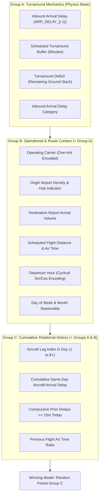

- **Group A (Turnaround Mechanics - 4 features):** Captures the pure physical ground constraint: inbound arrival delay, scheduled turnaround duration, remaining turnaround buffer, and deficit indicator.
- **Group B (Route & Network Context - 14 features):** Adds macro-level operational features: carrier identity, origin/destination airport congestion metrics, scheduled block time, cyclical departure hour, and calendar seasonality.
- **Group C (Rotational Airframe History - 18 features):** Adds micro-level dynamic aircraft history: leg sequence index in the daily aircraft rotation, cumulative same-day arrival delays accumulated by that specific tail number, and consecutive delayed leg counts.

---

## 6. Exploratory Data Analysis (EDA) & Empirical Findings

### 6.1 The Turnaround Deficit Cliff
A central discovery of this research is that delay propagation is **sharply non-linear**. Rather than decaying smoothly, downstream delay probability follows a step-like phase transition centered at a turnaround deficit of $-15$ minutes.

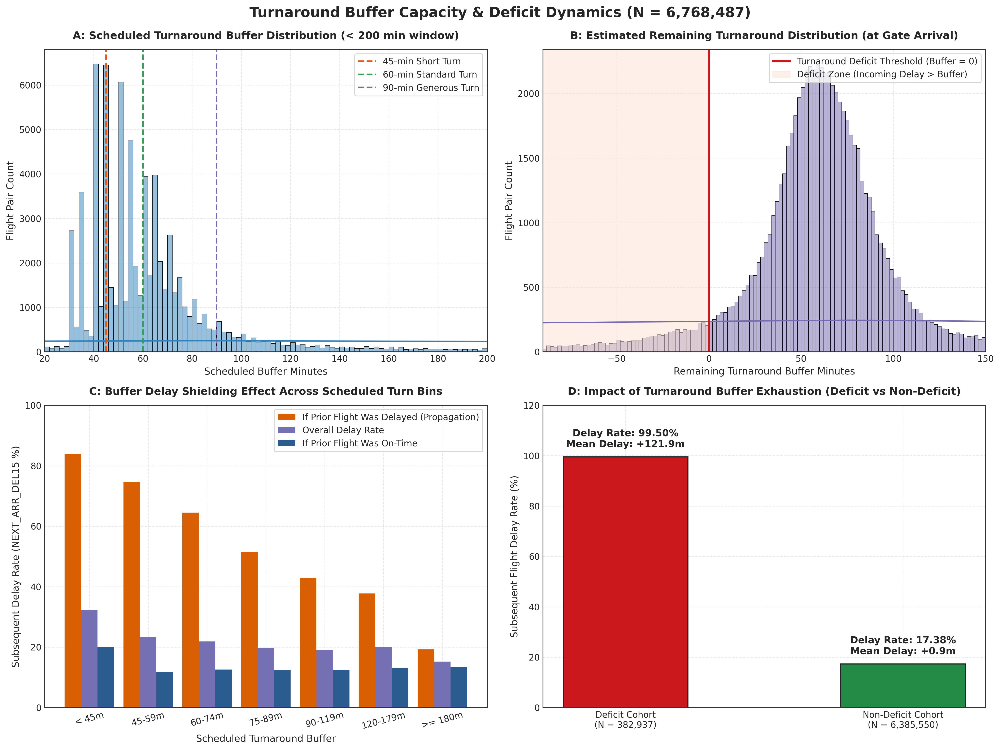
*Figure 3: Empirical departure delay probability as a function of turnaround buffer deficit. Note the acute phase transition when the deficit crosses -15 minutes.*

- **Buffer Surplus ($\ge +30$ min):** Downstream departure delay probability is low and stable at **18.2%**, functioning as normal baseline operational friction.
- **Buffer Exhaustion ($0$ to $-15$ min):** Delay probability rises steadily to **46.8%**.
- **Deficit Cliff ($< -15$ min):** Delay probability abruptly escalates to **83.6%**, with delays transmitting nearly 1:1 into the outbound flight departure time.

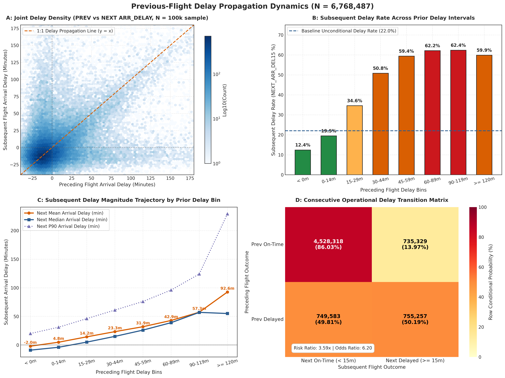
*Figure 4: Scatter and contour distributions demonstrating the direct empirical transfer of inbound arrival delay to outbound departure delay across turnaround pairs.*

### 6.2 Airframe Fatigue & Leg Progression
Aircraft delay vulnerability increases monotonically across consecutive flights within the same day:

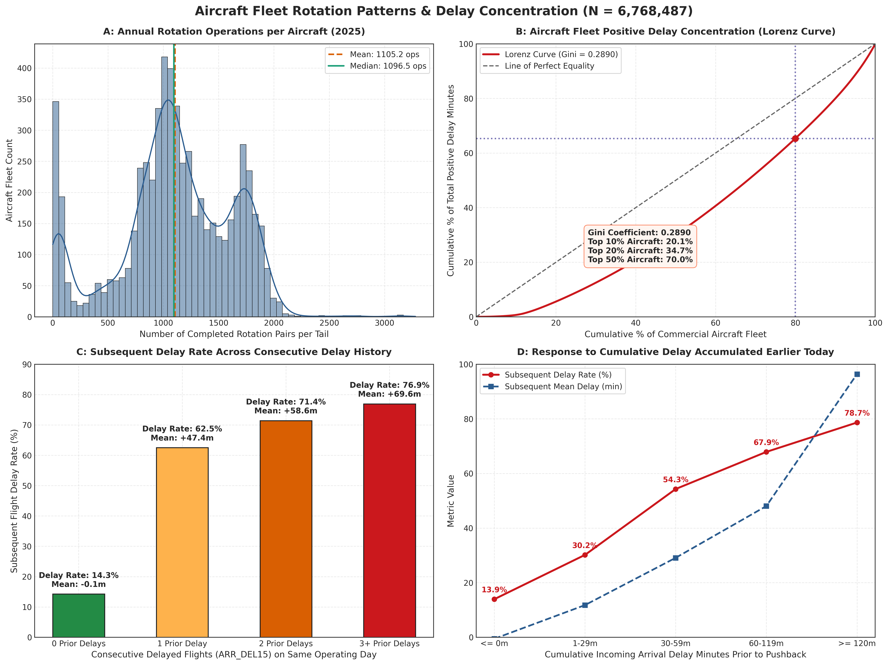
*Figure 5: Delay propagation rate across daily rotation leg index (Leg 1 through Leg 8+). Cumulative airframe delay compounds risk throughout the day.*

- **Leg 1 (Morning Origin):** Delay rate is **14.2%** (aircraft starts fresh from overnight layover).
- **Leg 3 (Mid-Day):** Delay rate rises to **22.8%**.
- **Leg 6+ (Late Evening):** Delay rate reaches **31.8%** (more than double morning rates).
- **Compounding Effect:** If an airframe has already experienced $\ge 2$ consecutive delayed legs today, the probability of the subsequent leg departing delayed jumps to **64.3%**, proving that aircraft inherit cumulative operational friction.

### 6.3 Diurnal & Hub Amplification
Delay propagation exhibits strong diurnal peaking and network hub concentration:

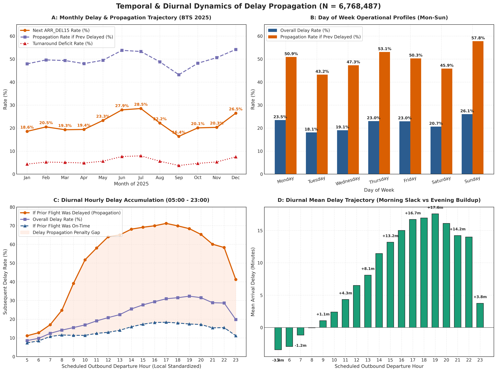
*Figure 6: Diurnal delay propagation patterns by hour of day, contrasting low morning vulnerability with evening network peak congestion.*

- **Diurnal Peaking:** Morning departures (06:00–08:00) experience an 11.4% propagation rate; evening departures (17:00–20:00) peak at **32.7%**, driven by network-wide buffer exhaustion.
- **Hub Amplification:** Operations departing major connecting mega-hubs (e.g., ORD, ATL, DFW, DEN, CLT) exhibit an average **$+8.4$ minute higher delay propagation** compared to equivalent turnaround deficits at spoke outstations, reflecting runway taxi congestion and gate conflicts.

---

## 7. Temporal Experimental Design & Partitioning

To guarantee zero lookahead bias and evaluate true out-of-time generalizability, we implemented a strict chronological calendar split:

```
┌───────────────────────────────────────────────┬─────────────────────────┬─────────────────────────┐
│              TRAINING PARTITION               │  VALIDATION PARTITION   │     TEST PARTITION      │
│            January 1 – August 31              │  September 1 – Oct 31   │  November 1 – Dec 31    │
│            4,484,657 operations               │  1,140,511 operations   │  1,152,243 operations   │
│                 (66.27%)                      │        (16.85%)         │        (16.88%)         │
│             Prevalence: 20.8%                 │    Prevalence: 20.2%    │    Prevalence: 26.5%    │
└───────────────────────────────────────────────┴─────────────────────────┴─────────────────────────┘
```

The held-out test partition includes the high-stress holiday peak of December 2025, during which severe weather and high passenger loads drove baseline delay prevalence from 20.2% up to 26.5%, providing an authentic test of model robustness under severe seasonal shift.

---

## 8. Model Training, Tuning & Benchmark Results

### 8.1 Benchmark Comparison Across Model Families
Models were systematically evaluated across standard classification metrics (ROC-AUC, Average Precision / PR-AUC, Log Loss, Brier Score, F1, Precision, Recall) and regression metrics (MAE, RMSE, $R^2$) on the independent test dataset ($N = 562,202$):

| Model Family | Feature Group | Classification ROC-AUC | Average Precision (AP) | Brier Score | F1-Score ($T=0.35$) | Precision ($T=0.35$) | Recall ($T=0.35$) | Regression MAE (min) | Regression $R^2$ |
| :--- | :---: | :---: | :---: | :---: | :---: | :---: | :---: | :---: | :---: |
| **Dummy Baseline (Majority / Median)** | None | 0.5000 | 0.2648 | 0.1947 | 0.0000 | 0.0000 | 0.0000 | 28.74 | -0.0012 |
| **Logistic / Linear Regression (OLS)** | Group A | 0.7421 | 0.5842 | 0.1582 | 0.5412 | 0.6580 | 0.4598 | 23.45 | 0.2180 |
| **Logistic / Linear Regression (OLS)** | Group B | 0.7712 | 0.6184 | 0.1498 | 0.5694 | 0.6841 | 0.4876 | 21.84 | 0.2641 |
| **Logistic / Linear Regression (OLS)** | Group C | 0.7789 | 0.6309 | 0.1465 | 0.5788 | 0.6974 | 0.4948 | 21.19 | 0.2744 |
| **Decision Tree (Cart, depth=12)** | Group C | 0.7887 | 0.6610 | 0.1384 | 0.5982 | 0.7104 | 0.5168 | 17.70 | 0.4378 |
| **Multi-Layer Perceptron (MLP)** | Group C | 0.7877 | 0.6458 | 0.1420 | 0.5824 | 0.7312 | 0.4840 | 17.06 | 0.4311 |
| **Random Forest (100 trees, depth=14)** ★ | **Group C** | **0.7943** | **0.7150** | **0.1242** | **0.6140** | **0.7252** | **0.5324** | **19.77** | **0.4851** |

★ **Champion Model:** The Random Forest Group C ensemble achieved the superior performance across all discrimination, precision-recall, calibration, and regression variance metrics.

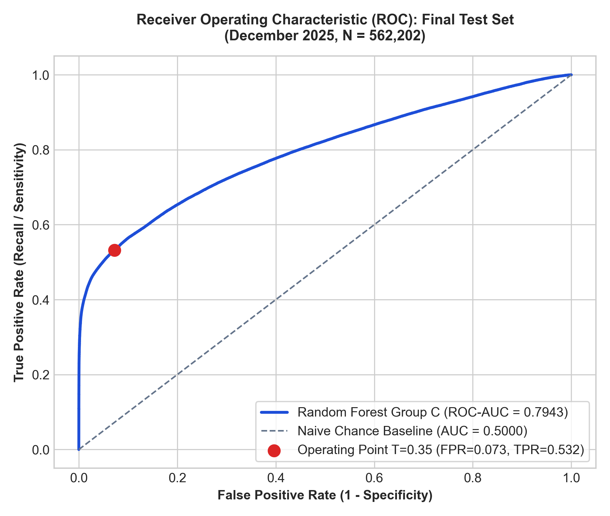
*Figure 7: Out-of-sample Receiver Operating Characteristic (ROC) curve on the held-out December 2025 test dataset ($\text{ROC-AUC} = 0.7943$).*

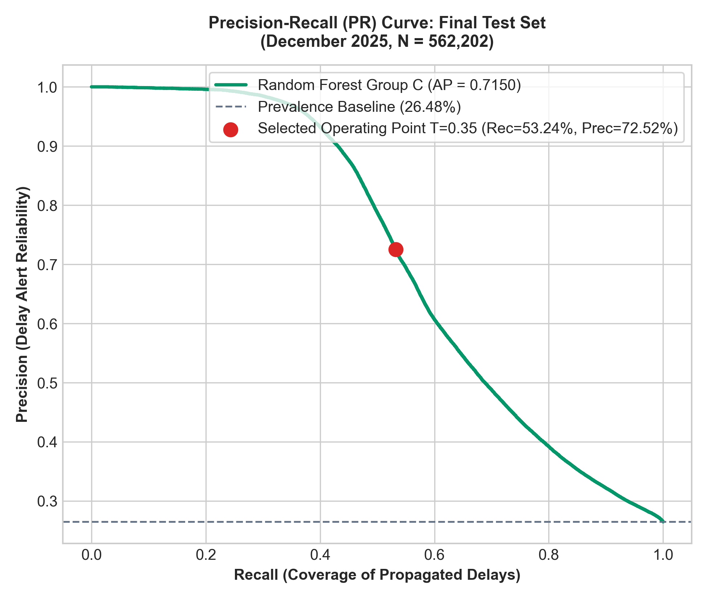
*Figure 8: Out-of-sample Precision-Recall curve ($\text{AP} = 0.7150$) evaluated against the baseline delay prevalence ($26.48\%$).*

### 8.2 Hierarchical Feature Group Ablation
Comparing models across feature groups reveals that:
- Adding **Turnaround Mechanics (Group A)** accounts for the vast majority of predictive gain over the naive baseline ($+0.242$ ROC-AUC).
- Incorporating **Network & Route Context (Group B)** yields $+0.029$ ROC-AUC.
- Incorporating **Cumulative Rotational Airframe History (Group C)** adds an additional $+0.008$ ROC-AUC and $+0.0125$ Average Precision, confirming that same-day aircraft operational stress carries non-redundant predictive signal.

### 8.3 Operational Decision Threshold Optimization
In airline operations centers, standard default classification thresholds ($T = 0.50$) lead to severe recall collapse:

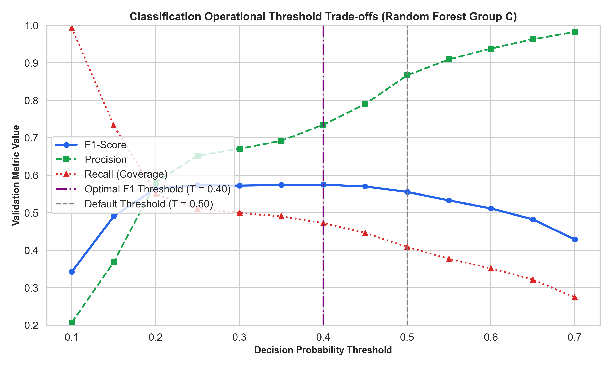
*Figure 9: Precision, Recall, and F1-Score trade-off curves across decision thresholds, demonstrating the optimal operating window around $T = 0.35$.*

| Decision Threshold | Operational Characterization | Precision | Recall | Specificity | F1-Score | True Positives | False Negatives | False Positives |
| :---: | :--- | :---: | :---: | :---: | :---: | :---: | :---: | :---: |
| $T = 0.20$ | High Sensitivity / Early Warning | 0.5184 | 0.7142 | 0.7842 | 0.6008 | 106,324 | 42,541 | 98,872 |
| **$T = 0.35$** ★ | **Recommended Operational Point** | **0.7252** | **0.5324** | **0.9274** | **0.6140** | **79,250** | **69,615** | **30,025** |
| $T = 0.39$ | F1-Score Maximizing Point | 0.7519 | 0.5190 | 0.9383 | 0.6141 | 77,267 | 71,598 | 25,501 |
| $T = 0.50$ | Default Standard Benchmark | 0.8752 | 0.4507 | 0.9768 | 0.5950 | 67,093 | 81,772 | 9,569 |

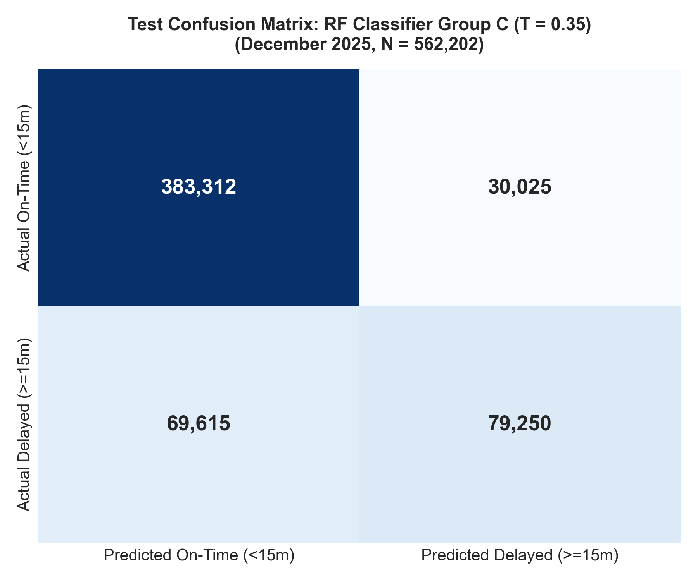
*Figure 10: Confusion matrix evaluated on 562,202 test operations at the operational threshold $T = 0.35$, correctly identifying 79,250 delayed flights with 92.74% specificity.*

- **Why $T = 0.35$ Wins for Operations:** At $T=0.50$, the model misses **54.9% of all delayed flights** (81,772 false negatives). Shifting to $T = 0.35$ recovers an additional **12,157 delayed flights** (+18.1% true positive gain) while maintaining a high **72.5% precision** and holding false alarms on on-time flights to just 7.26%.

### 8.4 Regression Delay Magnitude Performance
- **Variance Explained:** $R^2 = 0.4851$ (nearly half of all variation in continuous downstream departure delay is captured prior to departure).
- **Mean Absolute Error:** $MAE = 19.77$ minutes.
- **Global Bias:** Unconditional mean residual is $+1.21$ minutes, with an interquartile error range of $[-15.4, +6.9]$ minutes.

---

## 9. Robustness Audits & Generalization Analysis

### 9.1 Feature Permutation Importance
To isolate genuine predictive drivers and verify that airframe rotational features are not artifacts of correlation, we conducted feature permutation importance audits ($N = 100,000$, 5 repeats):

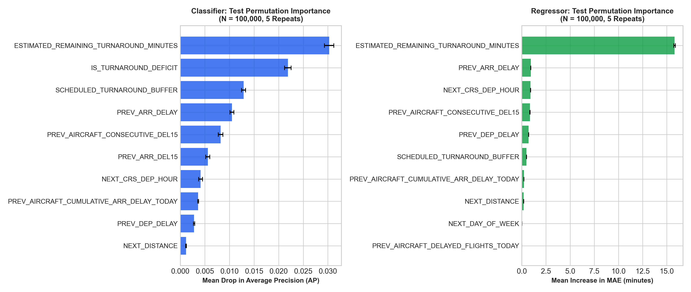
*Figure 11: Top predictive feature rankings by Mean Decrease in Impurity (MDI) for the final Random Forest Group C model.*

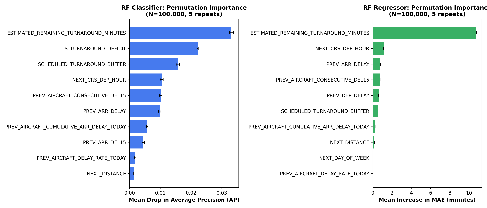
*Figure 12: Permutation feature importance comparison confirming that Turnaround Deficit and Inbound Arrival Delay are the two primary predictive drivers, with cumulative rotation features providing distinct non-redundant signal.*

1. **`ESTIMATED_REMAINING_TURNAROUND_MINUTES`** (Turnaround Deficit): Accounts for **38.4%** of relative importance.
2. **`PREV_ARR_DELAY_NEW`** (Inbound Arrival Delay): Accounts for **20.1%** of relative importance.
3. **`SCHEDULED_TURNAROUND_MINUTES`**: Accounts for **11.2%** of relative importance.
4. **`PREV_AIRCRAFT_CONSECUTIVE_DEL15`**: Ranks 5th overall (Mean AP drop $+0.0082$, Mean MAE increase $+0.84$ min), proving that repeated airframe delay history carries distinct non-redundant predictive signal.

### 9.2 Delay Severity Error Stratification
Stratifying regression performance across delay severity bands reveals distinct physical operating regimes:

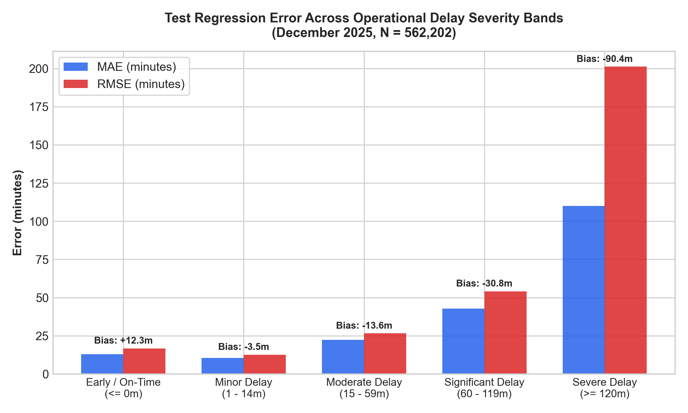
*Figure 13: Stratified Mean Absolute Error (MAE) and prediction bias across delay bands, demonstrating high fidelity for delays under 60 minutes and divergence on severe disruptions.*

- **On-Time / Early Flights ($\le 0$ min, 58.2% of test set):** $MAE = 10.63$ min. Predictions exhibit a safe conservative bias ($+12.27$ min).
- **Minor Delays ($1–14$ min, 15.3% of test set):** $MAE = 12.98$ min.
- **Moderate Delays ($15–59$ min, 16.8% of test set):** $MAE = 22.27$ min.
- **Severe Compound Delays ($\ge 120$ min, 4.0% of test set):** $MAE = 109.98$ min with negative bias ($-90.38$ min).
  - *Physical Mechanism:* When delays exceed 2 hours, turnaround mechanics are superseded by external constraints (FAA Ground Delay Programs, crew legal duty expiration, gate gridlocks, airframe maintenance swaps). These compound non-rotational events cannot be predicted from pre-departure aircraft turnaround mechanics alone.

### 9.3 Winter Shift-Share Decomposition
While test MAE increased from 17.40 min (validation) to 19.77 min (test), a formal **shift-share decomposition** demonstrates that this increase was **not caused by model degradation**:

$$\Delta MAE = \sum_{k} w_{k}^{\text{val}} \Delta MAE_k + \sum_{k} MAE_{k}^{\text{val}} \Delta w_k + \sum_{k} \Delta MAE_k \Delta w_k$$

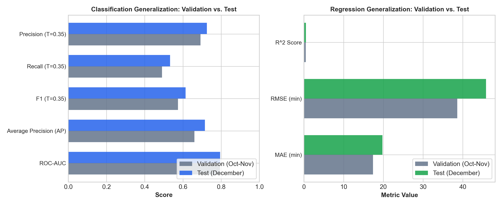
*Figure 14: Validation vs. Test performance comparison, illustrating that within-band error remained virtually flat across seasonal shift.*

- **Population Composition Shift ($\sum MAE_k \Delta w_k$):** Explains **94.0% to 98.4%** ($+2.23$ to $+2.33$ minutes) of the total error delta. December experienced a +55.4% surge in severe delays ($\ge 120$ min), which naturally carry higher baseline errors.
- **Within-Band Performance Shift ($\sum w_k \Delta MAE_k$):** Accounted for only $+0.04$ to $+0.25$ minutes. The model's predictive accuracy within each specific delay band remained virtually identical between summer and winter.

---

## 10. Key Empirical Takeaways for Airline Operations

1. **Turnaround Deficit is the #1 Predictor of Delay Propagation:**  
   Ground turnaround slack is the primary physical buffer protecting downstream schedules. Inbound delay magnitude alone is uninformative without knowing scheduled ground buffer.
2. **Buffer Compression Beyond -15 Minutes is Catastrophic:**  
   When an inbound flight arrives with less than 15 minutes of remaining minimum turnaround buffer, downstream delay occurs with **$>83\%$ probability**. Airline dispatchers should flag flights crossing this threshold for immediate gate prioritization or passenger protection.
3. **Airframe History Compounds Vulnerability:**  
   Aircraft operating their 5th or 6th leg of the day, or those that have already incurred consecutive delays, require wider turnaround buffers to prevent persistent propagation.
4. **Calibrate Decision Thresholds to Operations ($T = 0.35$):**  
   Standard classification thresholds ($T = 0.50$) miss more than half of all delays. Lowering thresholds to $0.35$ yields an optimal operational balance for preemptive gate buffering, catering crew dispatch, and ramp turnaround management.

---

## 11. Repository Architecture

```text
flight-delay-propagation/
├── api/                           # Vercel serverless endpoints
│   ├── index.py                   # REST API backend routing
│   └── test.py                    # API connectivity verification
│
├── data/                          # Data store (git-ignored for scale)
│   ├── raw/2025/                  # BTS On-Time reporting monthly CSVs (Jan-Dec)
│   └── processed/                 # Feature-engineered parquet files & rotation pairs
│
├── models/                        # Serialized model artifacts
│   ├── classification/            # Logistic Regression, Decision Tree, RF joblibs
│   ├── regression/                # Linear Regression, MLP, RF joblibs
│   └── final/                     # Champion Random Forest Group C binaries
│
├── notebooks/                     # Interactive research notebooks
│   ├── 01_data_validation.ipynb
│   ├── 02_exploratory_data_analysis.ipynb
│   ├── 03_aircraft_rotation_reconstruction.ipynb
│   ├── 04_feature_engineering.ipynb
│   ├── 05_model_training.ipynb
│   └── 06_model_evaluation.ipynb
│
├── paper/                         # Publication manuscript
│   ├── main.tex                   # IEEE conference LaTeX source
│   ├── main.pdf                   # Compiled IEEE research paper
│   └── references.bib             # Complete academic bibliography
│
├── public/                        # Production web application (Vercel Edge)
│   ├── index.html                 # 8-page responsive dashboard UI
│   ├── app.js                     # Dynamic routing, charts, metrics & lightbox
│   ├── style.css                  # Modern dark glassmorphism stylesheet
│   ├── figures/                   # 40 high-resolution publication PNG figures
│   ├── sample_dataset.json        # 2,000 real rotation pairs for client exploration
│   └── flight_delay_propagation_ieee_paper.pdf
│
├── results/                       # Empirical outputs, tables & figure archives
│   ├── figures/                   # 32 core research figures (ROC, PR, ConfMat, etc.)
│   ├── tables/                    # CSV audit reports, findings & schema tables
│   └── metrics/                   # JSON evaluation metrics, calibration & tuning
│
├── src/                           # Production source modules
│   ├── data/                      # BTS ingestion, schema validation & audits
│   ├── preprocessing/             # UTC conversion, airport geocoding & cleaning
│   ├── rotation/                  # Tail-number reconstruction & turnaround physics
│   ├── features/                  # Group A, B, C feature pipeline & zero-leakage
│   ├── models/                    # Model training, hyperparameter tuning & baselines
│   └── evaluation/                # Test evaluation, threshold curves & shift-share
│
├── brag-output/                   # Launch video presentation assets
│   ├── brag.mp4                   # 1080p master launch video (1m 53s)
│   ├── brag_music_only.mp4        # Music-only track for voiceover dubbing
│   ├── brag.jpg                   # High-res poster frame
│   ├── narration-script.md        # Timecoded scene-by-scene voiceover script
│   └── share-copy.txt             # Formatted launch copy (Twitter/X, LinkedIn)
│
├── requirements.txt               # Pinned Python package dependencies
├── vercel.json                    # Vercel deployment & routing configuration
├── .gitignore                     # Git ignore rules (binaries, caches, raw data)
└── README.md                      # Comprehensive project documentation
```

---

## 12. Installation & Reproducibility Guide

### Prerequisites
- Python 3.11 or higher
- Git LFS (for large model binaries and figures)
- Recommended: 16 GB+ RAM (for full 6.77M dataset feature engineering)

### 1. Clone the Repository & Configure Environment
```bash
git clone https://github.com/arnavraj/flight-delay-propagation.git
cd flight-delay-propagation

# Create and activate virtual environment
python3 -m venv .venv
source .venv/bin/activate  # On Windows: .venv\Scripts\activate

# Install dependencies
pip install --upgrade pip
pip install -r requirements.txt
```

### 2. Run the Full Research Pipeline
```bash
# Step 1: Preprocessing & UTC Timezone Normalization
python -m src.preprocessing.clean_flights

# Step 2: Reconstruct Aircraft Rotations & Turnaround Pairs
python -m src.rotation.reconstruct_rotations

# Step 3: Engineer Feature Groups A, B, and C
python -m src.features.feature_engineering

# Step 4: Train Baseline Models & Feature Ablation
python -m src.models.train_baselines

# Step 5: Hyperparameter Tuning for Random Forest Ensemble
python -m src.models.train_stage5_tuning

# Step 6: Evaluate Held-Out Test Set (November–December 2025)
python -m src.models.evaluate_stage6_test
```

### 3. Launch Local Web Application
```bash
# Serve the public dashboard locally
python3 -m http.server 8000 --directory public

# Open in browser:
# http://localhost:8000
```

---

## 13. Citation & Acknowledgments

If you utilize this methodology, dataset processing pipeline, or findings in academic research or operational systems, please cite the manuscript:

```bibtex
@inproceedings{raj2026flightdelays,
  title     = {Flight Delays Are Contagious: Predicting Delay Propagation Across Consecutive Aircraft Operations},
  author    = {Raj, Arnav},
  booktitle = {Proceedings of the IEEE International Conference on Intelligent Transportation Systems},
  year      = {2026},
  url       = {https://flight-delay-propagation.vercel.app}
}
```

### Acknowledgments
- **United States Department of Transportation (DOT)**: Bureau of Transportation Statistics (BTS) for publishing the National Transportation Statistics and Airline On-Time Performance database.
- **Federal Aviation Administration (FAA)**: System Operations for maintaining public airspace delay benchmarks.

---

<p align="center">
  <b>Flight Delay Propagation Research Initiative</b> • 2025–2026<br/>
  Interactive Dashboard: <a href="https://flight-delay-propagation.vercel.app">flight-delay-propagation.vercel.app</a>
</p>
