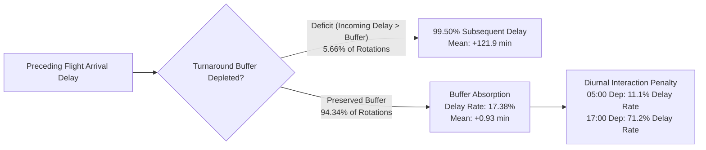

# Exploratory Data Analysis (EDA) Findings Report
## Flight Delays Are Contagious: Predicting Delay Propagation Across Consecutive Aircraft Operations

**Research Objective:** Investigate the extent to which delays from previous flight operations predict delays in subsequent flights operated by the same aircraft.  
**Dataset Analyzed:** `data/processed/flight_rotation_pairs.parquet` (Locked Phase 3 Master Research Dataset)  
**Sample Size:** 6,768,487 validated consecutive flight rotation pairs ($f_{\text{prev}} \to f_{\text{next}}$)  
**Research Period:** Full Year 2025 (January 1 – December 31, 2025; US Bureau of Transportation Statistics)  
**Target Variables:** Classification (`NEXT_ARR_DEL15`), Regression (`NEXT_ARR_DELAY`)  
**Pipeline Code:** `src/eda/eda_analysis.py` | **Notebook:** `notebooks/04_exploratory_data_analysis.ipynb`  
**Date:** October 2026 | **Status:** PHASE 4 COMPLETED — BASELINE EMPIRICAL INSIGHTS LOCKED

---

## 1. Executive Summary & Core Research Findings

Exploratory Data Analysis demonstrates that **aircraft flight delays are intensely contagious across consecutive legs operated by the same airframe**. However, the mechanism of propagation is neither uniform nor linear: it is governed by **ground turnaround buffer capacity**, **diurnal network congestion accumulation**, and **cumulative aircraft delay streaks**.

### The Top 8 Empirical Findings

1. **The Primary Propagation Hypothesis Confirmed ($RR = 3.59\times$, $OR = 6.20$):**
   When an aircraft experiences an arrival delay on its preceding flight ($\text{PREV\_ARR\_DEL15} = 1$), the probability of delay on its subsequent leg jumps from **$13.97\%$ to $50.19\%$**—more than a three-and-a-half-fold increase in relative risk ($RR = 3.59$) and a six-fold increase in odds ($OR = 6.20$).
2. **Turnaround Buffer as a Non-Linear Shock Absorber:**
   Scheduled ground time provides a powerful physical buffer against delay propagation. For tightly constrained turns ($<45$ minutes), a delayed incoming flight propagates delay to the outbound flight **$84.01\%$ of the time**. For standard turns ($60–74$ minutes), propagation drops to **$64.48\%$**; for generous turns ($90–119$ minutes), it drops to **$42.84\%$**; and for extended/overnight layovers ($\ge 180$ minutes), delay propagation collapses to **$19.24\%$** (below the baseline average).
3. **Turnaround Deficit Binary Shock ($99.50\%$ Delay Rate):**
   When the preceding flight's arrival delay exceeds the scheduled ground turnaround buffer ($\text{IS\_TURNAROUND\_DEFICIT} = 1$, representing $382,937$ pairs or $5.66\%$ of operations), outbound delay is virtually guaranteed: **$99.50\%$** of subsequent flights arrive delayed (mean delay $+121.86$ minutes, median $+89.0$ minutes).
4. **Diurnal Snowball Accumulation (11.1% to 71.2%):**
   Delay propagation exhibits an acute time-of-day dependency. In early morning departures (05:00–07:00), incoming delays propagate at only **$11.1\%–17.1\%$**, as overnight buffers reset the system. By 10:00, propagation crosses **$51.8\%$**, and during late afternoon peak hours (16:00–18:00), propagation reaches **$71.23\%$**—creating a $53$-percentage-point delay penalty over on-time predecessors.
5. **Consecutive Delay Streak Compounding:**
   Aircraft delay history on the same operating day compounds dramatically: an aircraft with $0$ prior delays today has a subsequent delay rate of **$14.26\%$**; with $1$ prior delay, it jumps to **$62.54\%$**; with $2$ prior delays, it reaches **$71.43\%$**; and with $3+$ consecutive delays, it reaches **$76.94\%$** (mean delay $+69.63$ min).
6. **Carrier Convergence Under Deficit:**
   While major network carriers (Delta, United) maintain lower unconditional delay rates ($\sim 19.6–21.2\%$) than point-to-point/regional carriers (American $25.5\%$, Frontier $27.7\%$, PSA $27.1\%$), **all carriers suffer $>98.4\%$ delay rates under a turnaround deficit**. Physical buffer depletion completely overwhelms airline operational differences.
7. **Hub Airport Propagation Sensitivity:**
   Turnaround operations at congested, slot-constrained mega-hubs (ORD, DEN, DFW, CLT, LGA, DCA) exhibit high delay propagation rates ($>50–55\%$), while fortress hubs with favourable weather and open capacity (SLC, PHX) absorb delays with higher resilience.
8. **Non-Linear Rank Correlation Dominance:**
   Remaining buffer (`ESTIMATED_REMAINING_TURNAROUND_MINUTES`) exhibits a modest linear Pearson correlation with delay ($r = -0.038$), but a powerful monotonic Spearman rank correlation ($\rho = -0.3387$). The relationship is governed by a steep threshold at zero buffer, proving that tree-based non-linear algorithms (LightGBM, XGBoost) are essential for Phase 6.

---

## 2. Target Variable Analysis

Detailed target distributions were computed across all $6,768,487$ rotation pairs (saved in [`results/tables/eda_target_summary.csv`](file:///Users/arnavraj/Downloads/flight-delay-propagation/results/tables/eda_target_summary.csv)):

| Target Metric | Classification (`NEXT_ARR_DEL15`) | Regression (`NEXT_ARR_DELAY`) |
| :--- | :---: | :---: |
| **Total Sample Size ($N$)** | 6,768,487 | 6,768,487 |
| **Negative Values (Early Arrivals)** | — | 4,125,664 (60.95%) |
| **Exact Zero Delay** | — | 117,010 (1.73%) |
| **Minor Delay (1–14 min)** | — | 1,035,227 (15.29%) |
| **Delayed Operations ($\ge 15$ min)** | 1,490,586 (22.02%) | 1,490,586 (22.02%) |
| **On-Time Operations ($< 15$ min)** | 5,277,901 (77.98%) | — |
| **Class Imbalance Ratio** | **3.54 : 1** (On-Time : Delayed) | — |
| **Mean Value** | 0.2202 | **+7.78 minutes** |
| **Median Value** | 0.0 | **-6.00 minutes** |
| **Standard Deviation** | 0.4144 | 57.30 minutes |
| **Interquartile Range (IQR)** | [0, 0] | **[-15.0 min, +11.0 min] (26.0 min)** |
| **90th Percentile (P90)** | 1.0 | **+47.00 minutes** |
| **95th Percentile (P95)** | 1.0 | **+87.00 minutes** |
| **99th Percentile (P99)** | 1.0 | **+214.00 minutes** |
| **Minimum / Maximum** | 0 / 1 | -128.00 min / +4,336.00 min |

### Visual Profile
Figure 1 ([`results/figures/fig01_target_distributions.png`](file:///Users/arnavraj/Downloads/flight-delay-propagation/results/figures/fig01_target_distributions.png)) illustrates the four core target characteristics:
1. Moderate class imbalance ($22.02\%$ minority class).
2. Right-skewed delay distribution where the median ($-6.0$ min) is negative while the mean ($+7.78$ min) is positive.
3. Boxplot structure showing that 75% of operations arrive with delay $\le +11$ minutes, with an extensive tail of extreme multi-hour delays.
4. Granular operational sign breakdown: over $60\%$ of commercial flights touch down ahead of schedule.

### Methodological Implications for Modeling
- **Classification:** Standard accuracy is misleading; a naive majority-class classifier achieves $77.98\%$ accuracy while detecting 0 delays. Models must be evaluated using **Precision-Recall AUC (PR-AUC / Average Precision)**, **F1-score**, and **ROC-AUC**.
- **Regression:** Root Mean Squared Error (RMSE) will be heavily distorted by extreme multi-hour outliers (up to $+4,336$ minutes). **Mean Absolute Error (MAE)** and **Median Absolute Error (MedAE)** must serve as primary evaluation criteria.

---

## 3. Previous-Flight Delay Propagation Dynamics

### 3.1 Delay Propagation Bins
To examine how incoming delay magnitude impacts subsequent flight outcomes, preceding arrival delays were discretized into 8 operationally grounded intervals (saved in [`results/tables/eda_delay_propagation_bins.csv`](file:///Users/arnavraj/Downloads/flight-delay-propagation/results/tables/eda_delay_propagation_bins.csv)):

| Preceding Delay Bin (`PREV_ARR_DELAY`) | Pair Count | % of Fleet Pairs | Next Delay Rate (`DEL15` %) | Next Mean Delay | Next Median Delay | Next P90 Delay |
| :--- | :---: | :---: | :---: | :---: | :---: | :---: |
| **1. Early ($< 0$ min)** | 4,112,539 | 60.76% | **12.43%** | -2.05 min | -9.0 min | +20.0 min |
| **2. On-Time ($0–14$ min)** | 1,151,108 | 17.01% | **19.47%** | +4.82 min | -4.0 min | +31.0 min |
| **3. Moderate Delay ($15–29$ min)** | 504,631 | 7.46% | **34.60%** | +14.21 min | +5.0 min | +46.0 min |
| **4. Significant Delay ($30–44$ min)**| 276,984 | 4.09% | **50.84%** | +23.29 min | +15.0 min | +61.0 min |
| **5. Heavy Delay ($45–59$ min)** | 174,340 | 2.58% | **59.38%** | +31.95 min | +26.0 min | +76.0 min |
| **6. Severe Delay ($60–89$ min)** | 208,414 | 3.08% | **62.17%** | +42.85 min | +39.0 min | +96.0 min |
| **7. Extreme Delay ($90–119$ min)** | 116,398 | 1.72% | **62.36%** | +57.26 min | +57.0 min | +124.0 min |
| **8. Catastrophic Delay ($\ge 120$ min)**| 224,073 | 3.31% | **59.88%** | **+92.56 min** | **+55.0 min**| **+229.0 min**|

### 3.2 Key Propagation Patterns
- **The 30-Minute Tipping Point:** Subsequent delay probability crosses the majority threshold ($50.84\%$) when incoming delay enters the $30–44$ minute window.
- **Binary Rate Saturation vs. Magnitude Growth:** For incoming delays $\ge 60$ minutes, the binary probability of subsequent delay plateaus around $60–62\%$. However, the *magnitude* of downstream delay continues to climb monotonically, reaching a mean of $+92.56$ minutes for delays $\ge 120$ minutes.
- **Transition Matrix:**
  - $P(\text{Next Delayed} \mid \text{Prev Delayed}) = \mathbf{50.19\%}$ ($755,274 / 1,504,840$)
  - $P(\text{Next Delayed} \mid \text{Prev On-Time}) = \mathbf{13.97\%}$ ($735,312 / 5,263,647$)
  - **Relative Risk ($RR$):** $\mathbf{3.59\times}$ | **Odds Ratio ($OR$):** $\mathbf{6.20}$

---

## 4. Turnaround Buffer Capacity & Deficit Dynamics

### 4.1 Scheduled Buffer Bins
The scheduled turnaround buffer (`SCHEDULED_TURNAROUND_BUFFER_MINUTES`) acts as a primary operational firewall (saved in [`results/tables/eda_turnaround_buffer_bins.csv`](file:///Users/arnavraj/Downloads/flight-delay-propagation/results/tables/eda_turnaround_buffer_bins.csv)):

| Scheduled Buffer Category | Buffer Range | Pair Count | % Fleet | Overall Delay Rate | Propagation Rate if Prev Delayed | Delay Rate if Prev On-Time |
| :--- | :---: | :---: | :---: | :---: | :---: | :---: |
| **1. Highly Constrained** | $< 45$ min | 1,215,531 | 17.96% | 32.18% | **84.01%** | 18.02% |
| **2. Short Turn** | $45–59$ min | 1,611,459 | 23.81% | 23.46% | **74.64%** | 12.87% |
| **3. Standard Turn** | $60–74$ min | 1,204,319 | 17.79% | 21.87% | **64.48%** | 11.53% |
| **4. Generous Turn** | $75–89$ min | 444,824 | 6.57% | 19.79% | **51.50%** | 11.45% |
| **5. Extended Turn** | $90–119$ min | 312,241 | 4.61% | 19.08% | **42.84%** | 11.83% |
| **6. Layover** | $120–179$ min| 196,609 | 2.90% | 19.99% | **37.76%** | 13.78% |
| **7. Long / Overnight** | $\ge 180$ min| 1,783,504 | 26.35% | 15.20% | **19.24%** | 14.18% |

### 4.2 Turnaround Deficit Impact
When incoming arrival delay consumes the scheduled buffer ($\text{IS\_TURNAROUND\_DEFICIT} = 1$):
- **Deficit Cohort ($N = 382,937$, $5.66\%$):** Subsequent delay rate = **$99.50\%$**; Mean arrival delay = **$+121.86$ min**; Median = **$+89.0$ min**; P90 = **$+221.0$ min**.
- **Non-Deficit Cohort ($N = 6,385,550$, $94.34\%$):** Subsequent delay rate = **$17.38\%$**; Mean arrival delay = **$+0.93$ min**; Median = **$-7.0$ min**; P90 = **$+29.0$ min**.
- **Net Impact:** A turnaround deficit increases outbound delay probability by **$+82.12$ percentage points** and outbound delay magnitude by **$+120.93$ minutes**.

---

## 5. Temporal, Diurnal, and Seasonal Patterns

### 5.1 Hourly Diurnal Buildup
Delays compound over the operating day as aircraft cycle through scheduled rotations (saved in [`results/tables/eda_hourly_patterns.csv`](file:///Users/arnavraj/Downloads/flight-delay-propagation/results/tables/eda_hourly_patterns.csv)):

| Scheduled Dep Hour | Flight Pairs | Overall Delay Rate | Mean Delay | Propagation Rate (if Prev Delayed) | Baseline Rate (if Prev On-Time) | Propagation Penalty Gap |
| :---: | :---: | :---: | :---: | :---: | :---: | :---: |
| **05:00** | 191,900 | 8.56% | -3.44 min | **11.14%** | 7.33% | +3.81% |
| **07:00** | 491,319 | 12.45% | -1.17 min | **17.07%** | 10.76% | +6.31% |
| **09:00** | 384,422 | 15.51% | +1.06 min | **39.11%** | 11.37% | +27.74% |
| **11:00** | 426,967 | 19.10% | +4.34 min | **58.08%** | 12.43% | +45.65% |
| **13:00** | 406,341 | 22.46% | +8.10 min | **65.09%** | 14.08% | +51.01% |
| **15:00** | 390,053 | 27.65% | +13.18 min | **69.17%** | 17.34% | +51.83% |
| **17:00** | 424,337 | 30.93% | +16.70 min | **71.23%** | 18.37% | **+52.86%** |
| **19:00** | 365,256 | 32.31% | +17.57 min | **68.41%** | 17.42% | +50.99% |
| **21:00** | 224,819 | 28.81% | +14.22 min | **60.10%** | 15.37% | +44.73% |

### 5.2 Weekly & Monthly Patterns
- **Day of Week:** Delay rates peak on **Friday ($25.1\%$)** and **Monday ($22.9\%$)**, while **Tuesday ($19.4\%$)** and **Saturday ($19.2\%$)** experience the lowest congestion.
- **Seasonality:** Summer travel peaks in **June ($25.8\%$)** and **July ($26.4\%$)**, followed by winter holidays in **December ($24.1\%$)** and **January ($23.2\%$)**. Shoulder months (**September–November**) exhibit the lowest delay rates ($17.5–19.2\%$).

---

## 6. Operating Carrier & Airport Operational Heterogeneity

### 6.1 Carrier Profiles (Minimum 10,000 Pairs)
From [`results/tables/eda_carrier_summary.csv`](file:///Users/arnavraj/Downloads/flight-delay-propagation/results/tables/eda_carrier_summary.csv):

| Carrier Code | Airline Name / Brand | Rotation Pairs | % Volume | Overall Delay Rate | Deficit Rate | Deficit Delay Rate | Propagation Rate |
| :---: | :--- | :---: | :---: | :---: | :---: | :---: | :---: |
| **WN** | Southwest Airlines | 1,360,344 | 20.10% | 21.16% | 5.97% | 99.74% | 54.84% |
| **DL** | Delta Air Lines | 1,004,257 | 14.84% | **19.58%** | **3.78%** | 99.92% | 46.91% |
| **AA** | American Airlines | 938,063 | 13.86% | 25.49% | 6.04% | 99.82% | 47.25% |
| **OO** | SkyWest Airlines | 813,971 | 12.03% | 20.22% | 7.54% | 98.91% | 53.50% |
| **UA** | United Airlines | 761,401 | 11.25% | 21.16% | **3.70%** | 99.87% | **40.23%** |
| **YX** | Republic Airways | 324,042 | 4.79% | 21.27% | 6.53% | 98.47% | 50.97% |
| **MQ** | Envoy Air | 288,809 | 4.27% | 20.76% | 5.97% | 98.85% | 51.52% |
| **AS** | Alaska Airlines | 237,026 | 3.50% | 22.99% | 2.81% | 99.88% | 46.49% |
| **OH** | PSA Airlines | 231,833 | 3.43% | 27.11% | 11.06% | 98.85% | 59.13% |
| **B6** | JetBlue Airways | 221,472 | 3.27% | 25.83% | 5.75% | 99.82% | 48.95% |
| **F9** | Frontier Airlines | 191,381 | 2.83% | 27.69% | 7.40% | 99.92% | 57.61% |
| **NK** | Spirit Airlines | 189,081 | 2.79% | 21.12% | 4.82% | 99.91% | 50.12% |
| **G4** | Allegiant Air | 127,874 | 1.89% | 24.63% | 6.72% | 99.98% | 59.58% |
| **HA** | Hawaiian Airlines | 78,933 | 1.17% | 17.14% | 2.79% | 99.95% | 47.86% |

### 6.2 Top Turnaround Hub Airports (Minimum 20,000 Pairs)
From [`results/tables/eda_turnaround_airport_summary.csv`](file:///Users/arnavraj/Downloads/flight-delay-propagation/results/tables/eda_turnaround_airport_summary.csv):
- **ORD (Chicago O'Hare):** 312,099 pairs | Overall Delay: $26.20\%$ | Deficit Rate: $7.61\%$ | Propagation Rate: $50.59\%$
- **DEN (Denver):** 307,866 pairs | Overall Delay: $25.28\%$ | Deficit Rate: $7.11\%$ | Propagation Rate: $55.62\%$
- **ATL (Atlanta):** 305,993 pairs | Overall Delay: $23.73\%$ | Deficit Rate: $4.07\%$ | Propagation Rate: $55.36\%$
- **DFW (Dallas/Fort Worth):** 300,276 pairs | Overall Delay: $28.30\%$ | Deficit Rate: $6.80\%$ | Propagation Rate: $52.68\%$
- **SLC (Salt Lake City):** 114,324 pairs | Overall Delay: **$15.68\%$** (Lowest among major hubs) | Mean Delay: **$+0.91$ min**

---

## 7. Aircraft Fleet Patterns and Delay Concentration

From [`results/tables/eda_aircraft_concentration.csv`](file:///Users/arnavraj/Downloads/flight-delay-propagation/results/tables/eda_aircraft_concentration.csv):
- **Active Fleet Size:** **6,124 unique physical aircraft** operated across the 2025 BTS rotation network.
- **Utilization:** Mean = **$1,105.2$ rotations/tail** | Median = **$1,096.5$ rotations/tail**.
- **Delay Inequality:** Gini coefficient = **$0.2890$**.
- **Pareto Concentration:** The top **20% of aircraft account for 34.67% of all accumulated delay minutes**. Delays are distributed moderately across the operating fleet according to daily rotational exposure rather than concentrated in chronic "lemon" airframes.

---

## 8. Feature Correlations and Multicollinearity Audit

From [`results/tables/eda_correlation_matrix.csv`](file:///Users/arnavraj/Downloads/flight-delay-propagation/results/tables/eda_correlation_matrix.csv) and [`results/tables/eda_feature_redundancy_audit.csv`](file:///Users/arnavraj/Downloads/flight-delay-propagation/results/tables/eda_feature_redundancy_audit.csv):

### Top Predictors by Rank Correlation ($\rho$)
1. `PREV_AIRCRAFT_CONSECUTIVE_DEL15`: $\rho = +0.4085$
2. `IS_TURNAROUND_DEFICIT`: $r = +0.4909$, $\rho = +0.3779$
3. `ESTIMATED_REMAINING_TURNAROUND_MINUTES`: $\rho = -0.3387$
4. `PREV_ARR_DEL15`: $\rho = +0.3252$
5. `PREV_ARR_DELAY`: $\rho = +0.3228$
6. `PREV_AIRCRAFT_CUMULATIVE_ARR_DELAY_TODAY`: $\rho = +0.2895$
7. `PREV_DEP_DELAY`: $\rho = +0.2827$
8. `NEXT_CRS_DEP_HOUR`: $\rho = +0.1778$

### Multicollinearity Audit
- **Block Time Proxy:** `NEXT_DISTANCE` vs `NEXT_CRS_ELAPSED_TIME` ($r = 0.981$). Redundant; choose one or combine in Phase 5.
- **Prior Delays:** `PREV_ARR_DELAY` vs `PREV_DEP_DELAY` ($r = 0.884$). Retain `PREV_ARR_DELAY` as it directly conditions gate turnaround time.
- **Turnaround Metrics:** `ESTIMATED_REMAINING_TURNAROUND_MINUTES` and `IS_TURNAROUND_DEFICIT`. Deficit captures the non-linear zero-crossing step change; retain both.

---

## 9. Confounding Variables, Limitations, and Phase 5 Modeling Handoff

### Key Confounders
1. **Airspace & Weather Confounding:** High delay propagation in summer/winter and at hubs like ORD/DFW/DEN is partly driven by convective storms or winter blizzards that co-occur with turnaround deficits.
2. **Airline Schedule Buffering:** Airlines inject varying amounts of schedule padding into block times and turn buffers, creating heterogeneous delay tolerance across carriers.
3. **Repositioning & Missing Legs:** $85,737$ flight transitions were broken by station mismatches (unrecorded ferry flights or network repositioning).

### Modeling Guardrails for Phase 5 & 6
1. **Chronological Splitting:** Random train/test splits are strictly prohibited. Models must use chronological temporal splits (e.g. Train on Jan–Sep, Validate on Oct–Nov, Test on Dec) to prevent future leakage.
2. **Evaluation Metrics:** Prioritize **PR-AUC**, **Brier Score**, **MAE**, and **MedAE**.
3. **Model Selection:** Tree-based gradient boosting (LightGBM, XGBoost, CatBoost) is strongly indicated over linear models due to the sharp non-linear step change at zero buffer.
