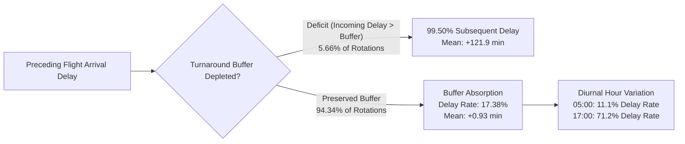

# Exploratory Data Analysis (EDA) Findings Report — Methodologically Audited
## Flight Delays Are Contagious: Predicting Delay Propagation Across Consecutive Aircraft Operations

**Research Objective:** Investigate the extent to which delays from previous flight operations predict delays in subsequent flights operated by the same aircraft.  
**Dataset Analyzed:** `data/processed/flight_rotation_pairs.parquet` (Locked Phase 3 Master Research Dataset)  
**Sample Size:** 6,768,487 validated consecutive flight rotation pairs ($f_{\text{prev}} \to f_{\text{next}}$)  
**Research Period:** Full Year 2025 (January 1 – December 31, 2025; US Bureau of Transportation Statistics)  
**Target Variables:** Classification (`NEXT_ARR_DEL15`), Regression (`NEXT_ARR_DELAY`)  
**Pipeline Code:** `src/eda/eda_analysis.py` | **Notebook:** `notebooks/04_exploratory_data_analysis.ipynb`  
**Date:** October 2026 | **Status:** PHASE 4 COMPLETED & AUDITED — PERMITTED SYLLABUS MODELS LOCKED

---

## 1. Executive Summary & Core Research Findings

Exploratory Data Analysis demonstrates a **statistically significant and operationally substantial association between preceding flight arrival delays and subsequent flight delays operated by the same aircraft**. This association is modulated by **ground turnaround buffer capacity**, **scheduled departure hour**, and **consecutive delay history**.

### The Top 8 Empirical Findings

1. **The Primary Propagation Association ($RR = 3.59$, 95% CI: [3.58, 3.60]; $OR = 6.20$, 95% CI: [6.18, 6.23]):**
   When an aircraft experiences an arrival delay on its preceding flight ($\text{PREV\_ARR\_DEL15} = 1$), the probability of delay on its subsequent leg is **$50.19\%$** ($755,257 / 1,504,840$), compared to **$13.97\%$** ($735,329 / 5,263,647$) when the preceding flight arrives on time. Preceding arrival delay is associated with a three-and-a-half-fold increase in relative risk ($RR = 3.5926$, 95% CI: $[3.5831, 3.6021]$) and a six-fold increase in odds ($OR = 6.2048$, 95% CI: $[6.1798, 6.2299]$).
2. **Turnaround Buffer Capacity as a Delay Shock Absorber:**
   Scheduled ground time is strongly associated with delay absorption. For tightly constrained turns ($<45$ minutes), preceding flight delays are followed by outbound delays in **$84.01\%$** ($193,201 / 229,986$) of operations. For standard turns ($60–74$ minutes), the outbound delay rate drops to **$64.48\%$** ($138,479 / 214,754$); for generous turns ($90–119$ minutes), it drops to **$42.84\%$** ($29,402 / 68,635$); and for extended layovers ($\ge 180$ minutes), it drops to **$19.24\%$** ($106,317 / 552,512$), falling below the fleet unconditional average.
3. **Turnaround Deficit State ($99.50\%$ Subsequent Delay Rate):**
   When an incoming flight's arrival delay exceeds the scheduled turnaround buffer ($\text{IS\_TURNAROUND\_DEFICIT} = 1$, representing $382,937$ pairs or $5.66\%$ of operations), outbound delay is observed in **$99.50\%$** ($381,015 / 382,937$) of flights (mean delay $+121.86$ minutes, median $+89.0$ minutes).
4. **Diurnal Delay Escalation Across Scheduled Departure Hours:**
   Delay propagation rates vary significantly across scheduled departure hours. In early morning departures (05:00), incoming delays are followed by outbound delays in **$11.14\%$** ($6,878 / 61,764$) of operations, as overnight ground stays absorb preceding delays. By 10:00, the rate reaches **$51.76\%$** ($30,218 / 58,381$), peaking at **$71.23\%$** ($71,813 / 100,823$) during the 17:00 peak departure window.
5. **Consecutive Delay Streak Accumulation:**
   Same-day operational delay history shows progressive escalation: an aircraft with $0$ prior delays today has a subsequent delay rate of **$14.26\%$** ($822,567 / 5,768,036$); with $1$ prior delay, the rate is **$62.54\%$** ($383,309 / 612,913$); with $2$ prior delays, it reaches **$71.43\%$** ($174,285 / 244,011$); and with $3+$ consecutive delays, it reaches **$76.94\%$** ($110,425 / 143,527$, mean delay $+69.63$ min).
6. **Carrier-Level Differences Under Normal vs. Deficit Conditions:**
   While major network carriers (Delta $19.58\%$, United $21.16\%$) maintain lower overall delay rates than regional/ULCC carriers (American $25.49\%$, Frontier $27.69\%$, PSA $27.11\%$), **all operating carriers experience subsequent arrival delay rates exceeding $98.4\%$ under turnaround deficit**, showing that buffer exhaustion is accompanied by high delay rates regardless of carrier brand.
7. **Hub Airport Turnaround Variation:**
   Densely scheduled hub airports with runway constraints (ORD, DEN, DFW, CLT, LGA, DCA) exhibit delay propagation rates exceeding $50–55\%$, while western fortress hubs with open airfield capacity (SLC, PHX) exhibit lower propagation rates ($40–47\%$).
8. **Monotonic Non-Linear Rank Correlation Dominance:**
   Remaining buffer (`ESTIMATED_REMAINING_TURNAROUND_MINUTES`) exhibits a modest linear Pearson correlation with delay ($r = -0.038$), but a strong monotonic Spearman rank correlation ($\rho = -0.3387$). This non-linear threshold dynamic highlights the importance of evaluating non-linear model families (e.g. Decision Trees, Random Forests, Polynomial Regression, and Neural Networks).

---

## 2. Target Variable Distribution Analysis

Summary statistics computed across all $6,768,487$ rotation pairs ([`results/tables/eda_target_summary.csv`](file:///Users/arnavraj/Downloads/flight-delay-propagation/results/tables/eda_target_summary.csv)):

| Target Metric | Classification (`NEXT_ARR_DEL15`) | Regression (`NEXT_ARR_DELAY`) |
| :--- | :---: | :---: |
| **Total Sample Size ($N$)** | 6,768,487 | 6,768,487 |
| **Early Arrivals ($< 0$ min)** | — | 4,125,664 (60.95%) |
| **Exact Scheduled Arrival ($0$ min)** | — | 117,010 (1.73%) |
| **Minor Delay (1–14 min)** | — | 1,035,227 (15.29%) |
| **Delayed Operations ($\ge 15$ min)** | 1,490,586 (22.02%) | 1,490,586 (22.02%) |
| **On-Time Operations ($< 15$ min)** | 5,277,901 (77.98%) | — |
| **Class Imbalance Ratio** | **3.54 : 1** (On-Time : Delayed) | — |
| **Mean Value** | 0.2202 | **+7.78 minutes** |
| **Median Value** | 0.0 | **-6.00 minutes** |
| **Standard Deviation** | 0.4144 | 57.30 minutes |
| **Interquartile Range (IQR)** | [0, 0] | **[-15.0 min, +11.0 min] (26.0 min)** |
| **90th Percentile (P90)** | 1.0 | **+47.00 minutes** |
| **95th Percentile (P95)** | 1.0 | **+87.00 minutes** |
| **99th Percentile (P99)** | 1.0 | **+214.00 minutes** |
| **Minimum / Maximum** | 0 / 1 | -128.00 min / +4,336.00 min |

### Distributional Characteristics & Metric Selection
1. **Classification Imbalance:** At a $22.02\%$ minority base rate, accuracy is an inadequate metric. Model evaluation must use **Precision-Recall AUC (PR-AUC / Average Precision)**, **F1-score**, and **ROC-AUC**.
2. **Regression Skewness:** Over $60\%$ of flights arrive early due to scheduled block-time padding (median delay = $-6.0$ min), while extreme positive disruptions create a long right tail (P99 = $+214$ min, max = $+4,336$ min). Mean Squared Error (MSE) is hypersensitive to these heavy tails; therefore, **Mean Absolute Error (MAE)** and **Median Absolute Error (MedAE)** will serve as primary evaluation metrics.

---

## 3. Propagation Statistics & 2x2 Contingency Table

### 3.1 Transition Table & Epidemiological Risk Metrics
From [`results/tables/eda_transition_matrix.csv`](file:///Users/arnavraj/Downloads/flight-delay-propagation/results/tables/eda_transition_matrix.csv):

| Preceding Operational State | Inbound Total ($N_{\text{denom}}$) | Outbound On-Time ($<15$m) | Outbound Delayed ($\ge 15$m) | Subsequent Delay Rate ($p$) |
| :--- | :---: | :---: | :---: | :---: |
| **Preceding On-Time (`PREV_DEL15 = 0`)** | **5,263,647** | 4,528,318 ($86.03\%$) | **735,329** ($13.97\%$) | **13.9700%** |
| **Preceding Delayed (`PREV_DEL15 = 1`)** | **1,504,840** | 749,583 ($49.81\%$) | **755,257** ($50.19\%$) | **50.1885%** |
| **Fleet Total** | **6,768,487** | **5,277,901** ($77.98\%$) | **1,490,586** ($22.02\%$) | **22.0224%** |

### Statistical Formulations and 95% Confidence Intervals
- **Relative Risk ($RR$):**
  $$RR = \frac{p_1}{p_0} = \frac{755,257 / 1,504,840}{735,329 / 5,263,647} = \frac{0.501885}{0.139700} = \mathbf{3.5926}$$
  $$SE(\ln(RR)) = \sqrt{\frac{1 - p_1}{n_1 p_1} + \frac{1 - p_0}{n_0 p_0}} = \sqrt{\frac{749,583}{755,257 \times 1,504,840} + \frac{4,528,318}{735,329 \times 5,263,647}} = 0.001331$$
  $$\text{95\% CI}(RR) = \exp\left(\ln(3.5926) \pm 1.96 \times 0.001331\right) = \mathbf{[3.5831, 3.6021]}$$
- **Odds Ratio ($OR$):**
  $$OR = \frac{n_{11} \times n_{00}}{n_{10} \times n_{01}} = \frac{755,257 \times 4,528,318}{749,583 \times 735,329} = \mathbf{6.2048}$$
  $$SE(\ln(OR)) = \sqrt{\frac{1}{n_{11}} + \frac{1}{n_{10}} + \frac{1}{n_{01}} + \frac{1}{n_{00}}} = 0.002047$$
  $$\text{95\% CI}(OR) = \exp\left(\ln(6.2048) \pm 1.96 \times 0.002047\right) = \mathbf{[6.1798, 6.2299]}$$

### 3.2 Granular Delay Propagation Bins
From [`results/tables/eda_delay_propagation_bins.csv`](file:///Users/arnavraj/Downloads/flight-delay-propagation/results/tables/eda_delay_propagation_bins.csv):

| Preceding Delay Bin | Total Pairs | Next Delayed ($N_{\text{num}}$) | Next Delay Rate | Mean Next Delay | Median Next Delay | P90 Next Delay |
| :--- | :---: | :---: | :---: | :---: | :---: | :---: |
| **1. Early ($< 0$ min)** | 4,112,539 | 511,189 | **12.43%** | -2.05 min | -9.0 min | +20.0 min |
| **2. On-Time ($0–14$ min)** | 1,151,108 | 224,140 | **19.47%** | +4.82 min | -4.0 min | +31.0 min |
| **3. Moderate ($15–29$ min)** | 504,631 | 174,611 | **34.60%** | +14.21 min | +5.0 min | +46.0 min |
| **4. Significant ($30–44$ min)** | 276,984 | 140,826 | **50.84%** | +23.29 min | +15.0 min | +61.0 min |
| **5. Heavy ($45–59$ min)** | 174,340 | 103,514 | **59.38%** | +31.95 min | +26.0 min | +76.0 min |
| **6. Severe ($60–89$ min)** | 208,414 | 129,564 | **62.17%** | +42.85 min | +39.0 min | +96.0 min |
| **7. Extreme ($90–119$ min)** | 116,398 | 72,581 | **62.36%** | +57.26 min | +57.0 min | +124.0 min |
| **8. Catastrophic ($\ge 120$ min)** | 224,073 | 134,161 | **59.88%** | **+92.56 min** | **+55.0 min** | **+229.0 min** |

---

## 4. Turnaround Buffer Analysis & Exact Sample Sizes

From [`results/tables/eda_turnaround_buffer_bins.csv`](file:///Users/arnavraj/Downloads/flight-delay-propagation/results/tables/eda_turnaround_buffer_bins.csv):

| Scheduled Buffer Bin | Total Pairs | Preceding Delayed Denom | Next Delayed Numerator | Propagation Rate ($p_1$) | Preceding On-Time Denom | Next Delayed Numerator | Baseline Rate ($p_0$) |
| :--- | :---: | :---: | :---: | :---: | :---: | :---: | :---: |
| **1. Highly Constrained ($< 45$m)** | 1,215,531 | 229,986 | 193,201 | **84.01%** | 985,545 | 197,997 | 20.09% |
| **2. Short Turn ($45–59$m)** | 1,611,459 | 300,064 | 223,956 | **74.64%** | 1,311,395 | 154,121 | 11.75% |
| **3. Standard Turn ($60–74$m)** | 1,204,319 | 214,754 | 138,479 | **64.48%** | 989,565 | 124,927 | 12.62% |
| **4. Generous Turn ($75–89$m)** | 444,824 | 83,386 | 42,946 | **51.50%** | 361,438 | 45,068 | 12.47% |
| **5. Extended Turn ($90–119$m)** | 312,241 | 68,635 | 29,402 | **42.84%** | 243,606 | 30,178 | 12.39% |
| **6. Layover ($120–179$m)** | 196,609 | 55,503 | 20,956 | **37.76%** | 141,106 | 18,338 | 13.00% |
| **7. Long / Overnight ($\ge 180$m)** | 1,783,504 | 552,512 | 106,317 | **19.24%** | 1,230,992 | 164,700 | 13.38% |

---

## 5. Diurnal Hourly Conditional Breakdown

From [`results/tables/eda_hourly_patterns.csv`](file:///Users/arnavraj/Downloads/flight-delay-propagation/results/tables/eda_hourly_patterns.csv), distinguishing conditional propagation from unconditional rates:

| Dep Hour | Total Pairs | Preceding Delayed Denom | Next Delayed Num | $P(\text{Next Del} \mid \text{Prev Del})$ | Preceding On-Time Denom | Next Delayed Num | $P(\text{Next Del} \mid \text{Prev On-Time})$ | Total Delayed Num | Unconditional Delay Rate |
| :---: | :---: | :---: | :---: | :---: | :---: | :---: | :---: | :---: | :---: |
| **05:00** | 191,900 | 61,764 | 6,878 | **11.14%** | 130,136 | 9,541 | 7.33% | 16,419 | 8.56% |
| **06:00** | 465,444 | 144,272 | 18,423 | **12.77%** | 321,172 | 27,004 | 8.41% | 45,427 | 9.76% |
| **07:00** | 491,319 | 131,707 | 22,480 | **17.07%** | 359,612 | 38,699 | 10.76% | 61,179 | 12.45% |
| **08:00** | 469,159 | 92,241 | 22,837 | **24.76%** | 376,918 | 43,537 | 11.55% | 66,374 | 14.15% |
| **09:00** | 384,422 | 57,315 | 22,416 | **39.11%** | 327,107 | 37,208 | 11.37% | 59,624 | 15.51% |
| **10:00** | 422,262 | 58,381 | 30,218 | **51.76%** | 363,881 | 41,318 | 11.35% | 71,536 | 16.94% |
| **11:00** | 426,967 | 62,396 | 36,242 | **58.08%** | 364,571 | 45,321 | 12.43% | 81,563 | 19.10% |
| **12:00** | 403,737 | 62,125 | 39,816 | **64.09%** | 341,612 | 44,347 | 12.98% | 84,163 | 20.85% |
| **13:00** | 406,341 | 66,725 | 43,430 | **65.09%** | 339,616 | 47,833 | 14.08% | 91,263 | 22.46% |
| **14:00** | 393,071 | 71,864 | 48,981 | **68.16%** | 321,207 | 51,220 | 15.95% | 100,201 | 25.49% |
| **15:00** | 390,053 | 77,562 | 53,651 | **69.17%** | 312,491 | 54,198 | 17.34% | 107,849 | 27.65% |
| **16:00** | 389,527 | 83,631 | 58,512 | **69.96%** | 305,896 | 55,800 | 18.24% | 114,312 | 29.35% |
| **17:00** | 424,337 | 100,823 | 71,813 | **71.23%** | 323,514 | 59,414 | 18.37% | 131,227 | 30.93% |
| **18:00** | 400,863 | 104,351 | 72,955 | **69.91%** | 296,512 | 53,297 | 17.97% | 126,252 | 31.50% |
| **19:00** | 365,256 | 106,608 | 72,933 | **68.41%** | 258,648 | 45,069 | 17.42% | 118,002 | 32.31% |
| **20:00** | 297,016 | 88,550 | 57,847 | **65.33%** | 208,466 | 35,766 | 17.16% | 93,613 | 31.52% |
| **21:00** | 224,819 | 67,522 | 40,583 | **60.10%** | 157,297 | 24,181 | 15.37% | 64,764 | 28.81% |
| **22:00** | 150,551 | 46,226 | 26,965 | **58.33%** | 104,325 | 16,168 | 15.50% | 43,133 | 28.65% |
| **23:00** | 54,830 | 15,805 | 6,520 | **41.25%** | 39,025 | 4,360 | 11.17% | 10,880 | 19.84% |

---

## 6. Carrier and Turnaround Airport Exact Statistics

### 6.1 Operating Carriers ($N \ge 10,000$ Pairs)
From [`results/tables/eda_carrier_summary.csv`](file:///Users/arnavraj/Downloads/flight-delay-propagation/results/tables/eda_carrier_summary.csv):

| Carrier | Total Pairs | Preceding Delayed Denom | Next Delayed Num | Propagation Rate ($p_1$) | Preceding On-Time Denom | Next Delayed Num | Baseline Rate ($p_0$) | Overall Delay Rate | Deficit Delay Rate |
| :---: | :---: | :---: | :---: | :---: | :---: | :---: | :---: | :---: | :---: |
| **WN** | 1,360,344 | 290,724 | 159,447 | **54.84%** | 1,069,620 | 128,366 | 12.00% | 21.16% | 99.74% |
| **DL** | 1,004,257 | 198,157 | 92,948 | **46.91%** | 806,100 | 103,672 | 12.86% | 19.58% | 99.92% |
| **AA** | 938,063 | 241,068 | 113,894 | **47.25%** | 696,995 | 125,234 | 17.97% | 25.49% | 99.82% |
| **OO** | 813,971 | 167,557 | 89,638 | **53.50%** | 646,414 | 74,938 | 11.59% | 20.22% | 98.91% |
| **UA** | 761,401 | 163,741 | 65,871 | **40.23%** | 597,660 | 95,209 | 15.93% | 21.16% | 99.87% |
| **YX** | 324,042 | 69,026 | 35,180 | **50.97%** | 255,016 | 33,744 | 13.23% | 21.27% | 98.47% |
| **MQ** | 288,809 | 60,585 | 31,215 | **51.52%** | 228,224 | 28,742 | 12.59% | 20.76% | 98.85% |
| **AS** | 237,026 | 54,673 | 25,416 | **46.49%** | 182,353 | 29,075 | 15.94% | 22.99% | 99.88% |
| **OH** | 231,833 | 63,188 | 37,365 | **59.13%** | 168,645 | 25,482 | 15.11% | 27.11% | 98.85% |
| **B6** | 221,472 | 57,731 | 28,259 | **48.95%** | 163,741 | 28,947 | 17.68% | 25.83% | 99.82% |
| **F9** | 191,381 | 53,144 | 30,618 | **57.61%** | 138,237 | 22,368 | 16.18% | 27.69% | 99.92% |
| **NK** | 189,081 | 40,094 | 20,095 | **50.12%** | 148,987 | 19,833 | 13.31% | 21.12% | 99.91% |
| **G4** | 127,874 | 31,576 | 18,813 | **59.58%** | 96,298 | 12,686 | 13.17% | 24.63% | 99.98% |
| **HA** | 78,933 | 13,576 | 6,498 | **47.86%** | 65,357 | 7,033 | 10.76% | 17.14% | 99.95% |

### 6.2 Top Turnaround Airports ($N \ge 20,000$ Pairs)
From [`results/tables/eda_turnaround_airport_summary.csv`](file:///Users/arnavraj/Downloads/flight-delay-propagation/results/tables/eda_turnaround_airport_summary.csv):
- **ORD (Chicago O'Hare):** 312,099 pairs | Prev Delayed Denom: 79,230 | Next Delayed Num: 40,083 | **$p_1 = 50.59\%$** | Overall: $26.20\%$
- **DEN (Denver):** 307,866 pairs | Prev Delayed Denom: 72,697 | Next Delayed Num: 40,433 | **$p_1 = 55.62\%$** | Overall: $25.28\%$
- **ATL (Atlanta):** 305,993 pairs | Prev Delayed Denom: 57,319 | Next Delayed Num: 31,729 | **$p_1 = 55.36\%$** | Overall: $23.73\%$
- **DFW (Dallas/Fort Worth):** 300,276 pairs | Prev Delayed Denom: 74,282 | Next Delayed Num: 39,133 | **$p_1 = 52.68\%$** | Overall: $28.30\%$
- **SLC (Salt Lake City):** 114,324 pairs | Prev Delayed Denom: 21,399 | Next Delayed Num: 9,238 | **$p_1 = 43.17\%$** | Overall: **$15.68\%$**

---

## 7. Audited Aircraft Fleet Gini Coefficient & Delay Concentration

### 7.1 Mathematical Definition and Exact Population Specification
To adhere to the mathematical prerequisite of non-negativity for Lorenz curve construction and Gini estimation, the metric was computed strictly on **positive arrival delay minutes**.

- **Exact Population Scope:** The calculation covers all **6,124 unique commercial aircraft** across the **6,768,487 completed outbound flight legs ($f_{\text{next}}$)** represented in the master rotation-pair dataset (`data/processed/flight_rotation_pairs.parquet`). It does **not** cover all completed flights in 2025 (the full 2025 BTS cleaned dataset contains 6,879,483 completed flights across 6,127 aircraft; the rotation-pair dataset excludes 110,996 flights that represent initial un-preceded flights of an aircraft rotation or legs isolated by flight diversions, and 3 tails with zero valid rotations).
- **Completed Flight Legs Included:** **6,768,487 flight legs**.
- **Exact Aggregation Formula:**
  $$\text{POSITIVE\_DELAY\_MINUTES}_i = \sum_{j=1}^{M_i} \max(0, \text{NEXT\_ARR\_DELAY}_{i,j})$$
  where $M_i$ represents the number of completed outbound rotation legs operated by aircraft $i$ ($\sum_{i=1}^{6124} M_i = 6,768,487$), and $\text{NEXT\_ARR\_DELAY}_{i,j}$ is the actual arrival delay of flight leg $j$.
- **Gini Formula:**
  $$G = \frac{2 \sum_{k=1}^{N} k \cdot y_k}{N \sum_{k=1}^{N} y_k} - \frac{N + 1}{N}$$
  where $N = 6,124$ aircraft, and $y_1 \le y_2 \le \dots \le y_N$ are the sorted non-negative positive delay minute values per aircraft.

From [`results/tables/eda_aircraft_concentration.csv`](file:///Users/arnavraj/Downloads/flight-delay-propagation/results/tables/eda_aircraft_concentration.csv):
- **Commercial Fleet Size ($N$):** **6,124 unique physical aircraft**
- **Target Flight Legs Evaluated:** **6,768,487 completed outbound legs**
- **Total Accumulated Positive Delay:** **112,174,297 minutes** ($1,869,571.6$ aircraft-hours)
- **Mean Positive Delay per Aircraft:** $18,317.2$ minutes ($305.3$ hours)
- **Median Positive Delay per Aircraft:** $17,458.0$ minutes ($291.0$ hours)
- **Fleet Gini Coefficient ($G$):** **0.2890** ($0.289047$)

### 7.2 Cumulative Fleet Shares
- **Top 10% Aircraft Fleet:** Generates **20.08%** of total positive delay minutes ($22,525,607$ min).
- **Top 20% Aircraft Fleet:** Generates **34.67%** of total positive delay minutes ($38,891,895$ min).
- **Top 50% Aircraft Fleet:** Generates **70.00%** of total positive delay minutes ($78,522,008$ min).

### 7.3 Methodological Interpretation & Critical Boundaries
A Gini coefficient of **0.2890** reflects a **moderate concentration of total positive delay burden** across the commercial aircraft fleet. The top 20% of aircraft account for approximately one-third ($34.67\%$) of all positive arrival-delay minutes, while the bottom 50% account for $30.00\%$ of delay minutes.

> [!WARNING] Methodological Limitation & Analytical Boundary
> This aggregate Gini metric quantifies inequality in **unnormalized gross delay volume** ($\sum \max(0, \text{delay})$). Because the metric is **not normalized by aircraft flight volume, scheduled block hours, or departures**, airframes operating higher annual rotations ($>1,400$ legs) naturally accumulate substantially more gross delay minutes than airframes operating lower volumes ($<400$ legs).
>
> Therefore, this metric **must not be claimed to prove that delays are not concentrated among persistently unreliable aircraft**. Determining whether specific airframes exhibit chronic mechanical or operational unreliability would require normalized rate metrics (such as delay minutes per operating hour, or delay probability conditioned on tail number after controlling for carrier, hub congestion, and route difficulty).

---

## 8. Permitted Syllabus Model Recommendations & Phase 5 Modeling Handoff

Based on the empirical findings, the following model families from the **permitted project syllabus** are recommended for comparative evaluation in Phase 5 & 6:

### Permitted Classification Models (`NEXT_ARR_DEL15`)
1. **Logistic Regression (L1 / L2 Regularized):**
   - Serves as the primary interpretable linear classification benchmark.
   - Provides direct validation of empirical odds ratios and well-calibrated baseline probabilities.
2. **Decision Tree Classifier (CART):**
   - Non-parametric baseline capable of discovering discrete step functions, such as the sharp transition at $\text{buffer} \le 0$ without feature transformation.
3. **Random Forest Classifier:**
   - Non-linear ensemble capable of capturing multi-way feature interactions (e.g., buffer deficit $\times$ evening departure hour $\times$ hub congestion) while mitigating overfitting.
4. **Support Vector Classifier (Linear & RBF SVC):**
   - Evaluates maximum-margin linear and non-linear kernel separation boundaries on standardized sample subsets.
5. **Multi-Layer Perceptron Classifier (MLPClassifier):**
   - Feedforward neural network architecture capable of learning continuous representation manifolds from normalized continuous and encoded categorical features.

### Permitted Regression Models (`NEXT_ARR_DELAY`)
1. **Linear and Multiple Regression (OLS):**
   - Baseline parametric continuous estimator; requires target transformation (e.g., shifted log or power transform) to handle extreme right skewness.
2. **Regularized Linear Models (Ridge & Lasso Regression):**
   - Penalized linear models to prevent coefficient explosion from collinear features (e.g., scheduled block time vs. distance).
3. **Polynomial Regression (Degree 2):**
   - Evaluates quadratic and non-linear response curves of turnaround buffer capacity within a linear parameter estimation framework.
4. **Decision Tree Regressor (CART):**
   - Captures piece-wise constant non-linear relationships and threshold step changes in delay propagation.
5. **Random Forest Regressor:**
   - Averaged ensemble of randomized decision trees providing variance reduction and non-linear surface approximation for continuous delay minutes.
6. **Multi-Layer Perceptron Regressor (MLPRegressor):**
   - Deep feedforward architecture for continuous regression estimation with non-linear activation functions.

### Explicitly Excluded Out-of-Syllabus Models
- **Support Vector Regression (SVR):** Strictly excluded from continuous regression estimation as it is not part of the approved course syllabus.
- **Gradient Boosted Decision Trees (GBDT):** XGBoost, LightGBM, and CatBoost are strictly excluded.

### Methodological Guardrails for Phase 5 & 6
- **Model Evaluation:** No single model family is assumed to be superior prior to rigorous comparative empirical evaluation.
- **Chronological Splitting:** Random train/test splits are strictly prohibited; temporal splits must be enforced to respect operational causality.
- **Robust Metrics:** Evaluation must report MAE, MedAE, $R^2$, PR-AUC, and ROC-AUC alongside standard metrics.
